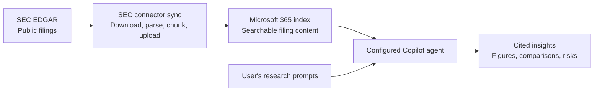

# SEC Copilot Connector

Import public SEC EDGAR filings into Microsoft 365 so users can search company
disclosures and ask a configured Copilot agent to extract financial insights
with source citations. This Python connector downloads filings, converts their
content into searchable text and Markdown tables, and synchronizes them to a
Microsoft 365 Copilot connector connection.



**Sync first, ask afterward.** The agent retrieves previously indexed content;
a prompt does not trigger a real-time SEC query. Run ingestion again (or schedule
it externally) to discover new filings, then allow time for Microsoft 365
indexing. The repository provides the connector, **not a deployable agent app**;
you configure the agent separately.

Choose the SEC-reporting companies and filing-date window relevant to your use
case. The connector is not tied to a particular company or industry. Commands
below use `AAPL`, `MSFT`, and `GOOG` as examples; replace them with your desired
tickers.

## Disclaimer and adopter responsibility

**Provided "AS IS" and "AS AVAILABLE", without warranties of any kind, express
or implied, including merchantability, fitness for a particular purpose and
noninfringement.** No support, maintenance, updates or service-level agreement
(SLA) is guaranteed. This is not an officially supported Microsoft product.

This project was predominantly AI-generated. Human review and testing do not
eliminate defects, security vulnerabilities or inaccurate results. Adopters
assume **operational ownership**, not ownership of the intellectual property:
you are responsible for evaluating, reviewing and testing the code for security,
compliance and fitness for your use, and for deploying, monitoring, maintaining,
enhancing and fixing bugs in your installation, at your own risk.

To the fullest extent permitted by applicable law, the authors and contributors
disclaim liability for claims, damages or other losses arising from use of, or
inability to use, this project. Fixes and enhancements via pull requests are
welcome so others can benefit; submission does not guarantee acceptance or
ongoing support.

**License status:** [Package metadata](pyproject.toml) declares MIT, but this
repository currently has no `LICENSE` file containing the full terms. This
disclaimer does not grant or change license rights; obtain clarification from
the repository owner before relying on licensing permissions.

## Demo

A sanitized demo replacement is pending. The previous recording is no longer
linked here because its UI contains identifying labels and creator metadata.
Removing these links does not remove the original public attachment or Git history.

## Choose your starting point

| Goal | Start here |
|---|---|
| Ingest filings for your own companies | [Setup and first import](#1-prepare-your-environment) below; setup and ingestion perform live Microsoft 365 writes. |
| Inspect one document without uploading | [Local content inspection](docs/operations.md#inspect-content-without-uploading); downloads from SEC but makes no Graph uploads. |
| Prepare a reproducible three-document v9 + OCR sample | [Exact-import runbook](docs/sample-v9-setup.md); public PNC filings, Graph-free preparation, then a separately authorized live import. |
| Ask questions about already indexed filings | [Configure an agent and ask questions](#7-configure-an-agent-and-ask-questions). |
| Operate or recover an existing installation | [Operations and troubleshooting](docs/operations.md). |

## What it supports

Supported filings include **10-K** annual reports, **10-Q** quarterly reports,
**8-K** current reports, **DEF 14A** proxy statements, amendments, and selected
HTML/text exhibits.

- **Richer schema:** 22 properties provide issuer, ticker, form, reporting period,
  document, and section context, with links to the actual SEC source document.
- **Financial-table fidelity:** removes duplicated layout content and improves
  header detection while preserving independent financial values and merged-cell
  relationships.
- **Historical coverage:** configurable filing-date windows, historical
  submissions, amendments, and selected exhibits.
- **Reliable synchronization:** checkpointed recovery, unchanged-upload skipping,
  and obsolete-item cleanup only after replacement uploads succeed.
- **Request-size protection:** validates the complete serialized Graph request
  against the configured 30 MiB (31,457,280-byte) ceiling.

> Imported items use a tenant-wide `everyone` read ACL. Use this connector for
> public SEC filings, not confidential documents. PDF exhibits are unsupported.
> Upload acknowledgment does not guarantee immediate search visibility or
> accurate Copilot answers.

HTML/text support does not imply general image, PDF or scanned-document support.
See [advanced workflows and known limits](#advanced-workflows-and-known-limits)
for processing-version, OCR and evaluation boundaries.

## 1. Prepare your environment

You need Git, Python 3.10+ (3.11 or 3.12 recommended), outbound HTTPS access to SEC
EDGAR and Microsoft Graph, and a Microsoft 365 tenant configured for the search
or Copilot experience you intend to use. Confirm applicable licenses and
connector capacity with your tenant administrator.

In Microsoft Entra admin center, create an **App registration** for your tenant.
Record its tenant ID and application/client ID, then create a client secret and
securely capture its **value**, not its secret ID. Add these Microsoft Graph
**application permissions**, and have an authorized administrator grant consent:

- `ExternalConnection.ReadWrite.OwnedBy`
- `ExternalItem.ReadWrite.OwnedBy`

Use that same app to create and operate the connection. You also need a real
organization/contact email for the SEC request user agent.
For Graph-free evaluation instead, follow the inspection or exact-preparation
path above; those do not require Azure credentials.

## 2. Download and install

Run in PowerShell. The commands use the virtual environment directly, so no
activation or execution-policy change is needed.
Use your organization's approved Python package source. Stop and resolve any
failed command before continuing.

```powershell
git clone https://github.com/svarukala/SEC-Copilot-Connector.git
Set-Location SEC-Copilot-Connector
python -m venv .venv
.\.venv\Scripts\python.exe -m pip install .
.\.venv\Scripts\sec-connector.exe --help
```

Keep the repository root as your working directory for all commands. Relative
cache and state paths are resolved from the working directory.

## 3. Set credentials and choose the scope

Replace the placeholders below. The secret prompt hides input; credentials
remain in this process environment. Do not commit secrets or include them in
logs, screenshots, or support requests.
The loader expands environment variables but does **not** load `.env` files.
Set these variables again in each new PowerShell process.

```powershell
$env:AZURE_TENANT_ID = "<tenant-id>"
$env:AZURE_CLIENT_ID = "<application-client-id>"
$env:AZURE_CLIENT_SECRET = [System.Net.NetworkCredential]::new(
    "", (Read-Host "Client secret value" -AsSecureString)
).Password
$env:SEC_USER_AGENT = "YourOrganization SEC-Connector (your-real-contact@company.com)"
Write-Output "Client secret configured: $([bool]$env:AZURE_CLIENT_SECRET)"
```

Edit the existing entries in [config/config.yaml](config/config.yaml); **do not
append duplicate YAML sections**. Choose your own new, alphanumeric connection
ID and date window. For example:

```yaml
azure:
  connection_id: "mysecfilings"
  connection_name: "SEC EDGAR Filings"

filings:
  start_date: "2021-09-10"
  end_date: null

sync:
  prune_missing_filings: false
```

This is a partial example: retain the other configuration entries, including
credential environment-variable references and form/exhibit selection.
The example selects **filing dates** from September 10, 2021 onward.
Dates are inclusive; this is not a rolling cutoff or a reporting-period filter.
The shipped configuration instead starts at **2019-09-09** and uses a
demonstration connection ID, so review it before running.

Leave OCR disabled for first-time setup. It requires Pillow, an approved local
Tesseract native bundle (including DLLs and the English model), and local image
assets; pytesseract is not required. See [offline OCR deployment](docs/operations.md#content-limitations-and-ocr).

## 4. Create the connection and schema

**Live Microsoft 365 action:** this creates the configured connection and schema.

```powershell
.\.venv\Scripts\sec-connector.exe -c .\config\config.yaml setup
```

Use a **new connection ID when moving from an older populated schema**. Do not
reset an existing connection just to try this release. Setup creates the
connection and follows schema provisioning, waiting up to 15 minutes; resolve
any reported error before proceeding. The same configuration is used below.

## 5. Start with a small single-company sample

```powershell
.\.venv\Scripts\sec-connector.exe -c .\config\config.yaml ingest -t AAPL --test --no-prune
```

**This uploads real content to Microsoft 365; it is not a dry run.** By default
it selects at most two filings for one ticker and five chunks per filing.
These are sampled filings, not complete coverage. `--save-payloads` also still
uploads; see [local inspection](docs/operations.md#inspect-content-without-uploading)
if you need a no-upload option.

## 6. Import your selected companies

After the sample succeeds, run without sampling limits:

```powershell
.\.venv\Scripts\sec-connector.exe -c .\config\config.yaml ingest -t AAPL,MSFT,GOOG --no-prune
```

The full run expands the sample. Tickers are processed sequentially; Graph PUTs
run with concurrency capped at five. Multi-year backfills can take hours.
Keep the process running, the machine awake, and network access available.

Watch the running terminal or [follow the log](docs/operations.md#monitor-a-run).
Do not run `status` while ingestion owns the destination lock. After an
interruption, use the same working directory, credentials, and configuration:

```powershell
.\.venv\Scripts\sec-connector.exe -c .\config\config.yaml resume
```

`resume` handles already queued work, not discovery of tickers the interrupted
run had not reached. Rerun `ingest` with your complete ticker list to include those
tickers; already completed filings refresh and unchanged item hashes skip PUTs.

For later updates, rerun the same `ingest` command. The connector is command-driven,
not an always-running service. Keep the destination-scoped database and cache,
avoid overlapping writers, and use an external scheduler if you need recurring
sync. `--no-prune` disables whole-filing pruning; it does not disable stale-item
cleanup after complete replacement uploads. Narrowing a date window does not
delete previously indexed filings.

## 7. Configure an agent and ask questions

After ingestion, allow time for Microsoft 365 indexing and verify your intended
filings are searchable. Upload acknowledgment alone does not establish retrieval
or answer accuracy.

Create a declarative agent in Agent Builder or Microsoft 365 Agents Toolkit.
Select **your new connection** as its knowledge source; restrict unrelated
sources and web search initially. If the custom connection is not selectable in
Agent Builder, use the explicit `GraphConnectors` binding in the agent guide.
Never put the ingestion application's client secret in the agent.

See [SEC Filings Analyst: agent setup and prompts](docs/agent-setup.md) for a
copy-ready agent description, instructions, starter prompts, and single-company
and peer-analysis examples.

Replace placeholders with companies and periods you actually ingested:

> For [company], summarize revenue, operating income, and the key disclosed
> business risks for [reporting period]. Cite the filing and table or section for
> each claim, preserve units and precision, and flag missing evidence.

> Compare [company A] and [company B] for [reporting period]. Retrieve each
> company's reported revenue and operating income separately. Align periods,
> units and metric definitions, cite each figure, and state where the available
> evidence does not support a fair comparison.

Check citations against the actual SEC documents. A sample may lack the passages
needed for a question; instructions cannot repair missing or unindexed content.

## Documentation map

| Reference | What you will find |
|---|---|
| [Agent setup and prompts](docs/agent-setup.md) | Connection binding, copy-ready instructions, starter prompts, optional skills and financial-precision guidance. |
| [Operations and troubleshooting](docs/operations.md) | Monitoring, recurring sync, history, resume/reprocess, OCR, schema upgrades and deletion. |
| [Exact three-document v9 + OCR sample runbook](docs/sample-v9-setup.md) | Fresh installation, public-filing manifest, native OCR, Graph-free preparation and digest-bound live import/retry. |
| [Read-only diagnostics](docs/diagnostics.md) | Baseline investigation and report comparison without repairs; standard-library offline mode and optional GET-only Graph checks. |
| [Evidence evaluation](docs/evidence-evaluation.md) | Tested scope, format limitations and repeatable offline/source-grounded evaluation rubric. |
| [Scoped maintenance](docs/maintenance.md) | Eligibility, reviewed plans, guarded apply/resume/rollback and recovery evidence. |
| [Configuration](config/config.yaml) and [Graph schema](config/schema.json) | Operational settings and the authoritative 22 property definitions. |
| [Portable handoff](HANDOFF.md) | Dated verification, publication/recovery status and remaining work for maintainers. |

## Advanced workflows and known limits

These are reference details, not extra first-installation steps. Package **1.0.1**
uses processing version **9**. A code upgrade or merge does not authorize live
reprocessing or deletion. Ordinary `resume` replays already prepared payloads
unchanged; it does **not** rebuild them with a newer parser. Read
[recovery and reprocessing](docs/operations.md#resume-refresh-or-rebuild) before
rebuilding selected work.

<details>
<summary>Processing evidence, OCR and scoped maintenance boundaries</summary>

The [evidence-packaging pilot](docs/evidence-packaging-pilot.md) is an experimental
exact-document workflow, not a broad live reprocessing procedure.
It documents offline results, a separately approved frozen-manifest loader, and
a controlled A/B evaluation protocol.

Processing version **9** adds bounded source-local symbol, cross-page and
narrative-separated note associations before page/section splitting. It keeps
original text and cites the owning table's document/page; repeated definitions,
unrelated headings/tables and exhausted context budgets are not guessed.
See the [v9 evidence and limits](docs/evidence-evaluation.md#processing-v9-note-association-follow-up).
The original processing version **8** added source-backed table-header context.
The [five-bank sample report](docs/evidence-v8-five-bank-sample.md) records the
25-document delivery and qualified user evaluations, not universal answer
accuracy. Its five added sources retain **17 pre-existing period-context
diagnostic gaps**. Ambiguous/long-distance notes, oversized context and unavailable
incorporated annual reports remain explicit limitations.

For an exact cached document in a completed sole-document filing, the
[scoped maintenance workflow](docs/maintenance.md) provides reviewed
`prepare`/`inspect`/`apply`/`resume`/`rollback` commands. It requires quiescing all
writers, retains remote/local recovery evidence, and permanently upgrades that
database to state format 4. This is separate from processing v9. A
[single-scope live validation](docs/maintenance-live-validation.md) passed storage
checks and bounded public-filing agent acceptance. The procedure is validated for its
supported single-document, non-OCR scope, not for all filings.
Offline-tested extensions support explicitly opted-in, fully prepared
single-document interrupted delivery, frozen local rotated-image OCR inputs,
and explicit complete multi-document inventories in completed, unsampled,
OCR-disabled filings. Multi-document plans use format 3; state format 4 and
plan formats 1/2/3 are unchanged by processing v9. Missing inventory/unprepared work,
ambiguous ownership, multi-document subsets, mixed provenance and multi-document
OCR remain unsupported; see the maintenance eligibility matrix. These
extensions have no live operator acceptance. Real-engine offline parser/chunker
validation passed for the bounded PNC 2025 director-header case, including the
full retained document; this does not establish general OCR or Copilot accuracy.

</details>
